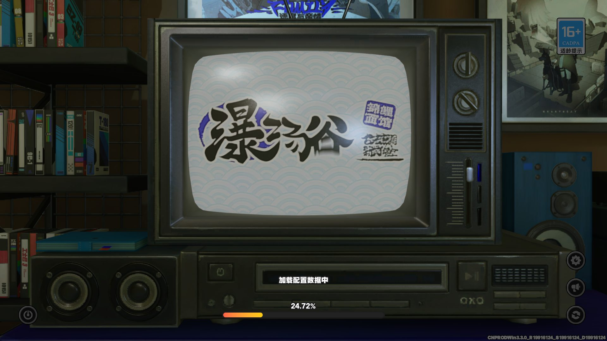
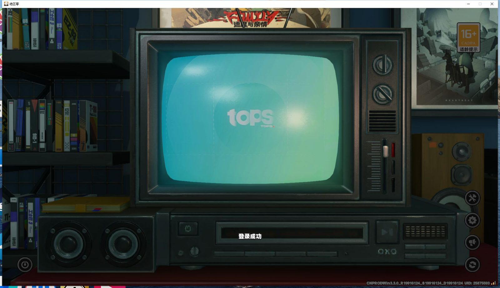
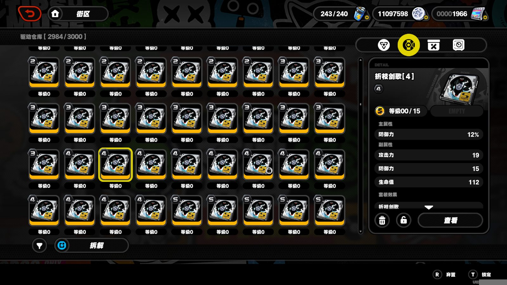
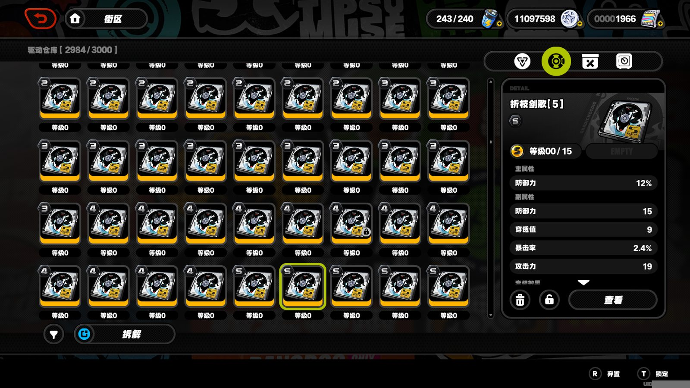
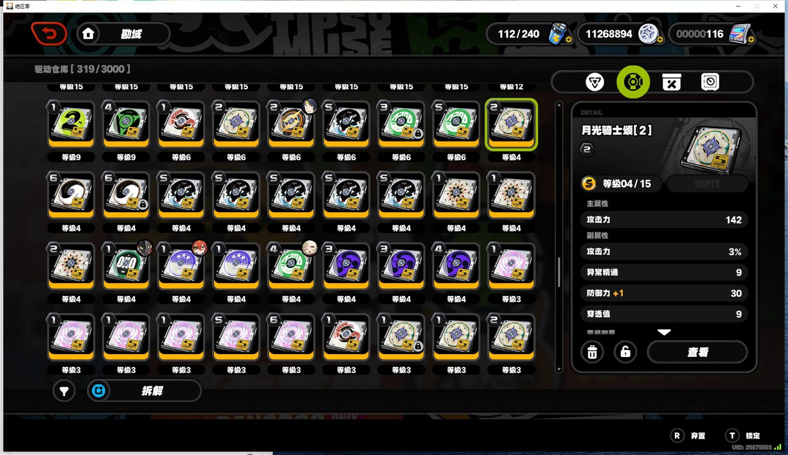
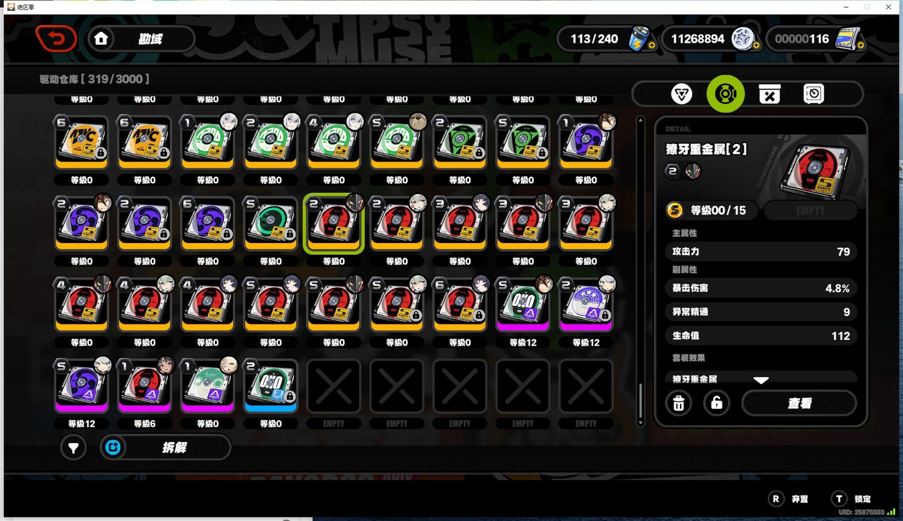
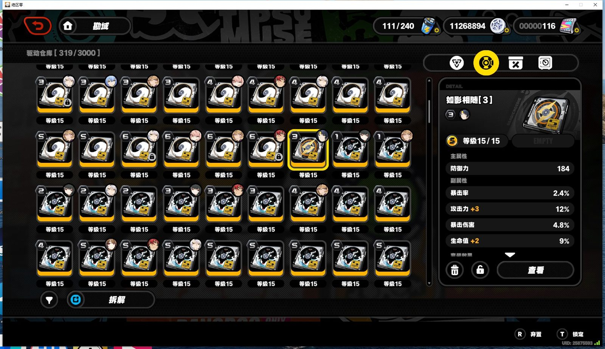

# E2E 实测报告（2026-10-31）

- 环境：Windows 实机 + 提权一条龙链（`run_app_once` 标准路径），游戏 1080p 全屏窗口
- 执行方式：单应用触发（计划任务免 UAC），全程框架截图连拍（`docs/e2e/` 内图片为原生 1920×1080 游戏帧）
- 日志：一条龙应用日志逐节点留痕（`执行成功` 收口），本文引用关键行

## 结果

**驱动盘清理标记 v1.0.0：执行成功（余位充足正确跳过）**

```
[11:33:33] disc_cleanup_app.py 186: 仓库容量: 319/3000 余位 2681 (门槛 200)
[11:33:33] 指令[ 驱动盘清理标记 ] 执行成功 返回状态 余位充足 跳过清理
[11:33:33] 指令[ 一条龙 ] 执行成功 返回状态 全部结束
```

| 截图 | 说明 |
|---|---|
|  | 应用启动：返回大世界成功（导航起点） |
|  | 提权链拉起游戏（加载页 24.72%） |

容量 OCR 正确锚定「仓库」标题（319/3000，非右上角邦布计数），余位 2681 > 门槛 200 → 按设计跳过清理。真实标记路径的完整遍历见后续版本（余位不足时触发）。

## 复测（2026-11-01 12:18，含全程录屏）

同环境同路径复测一轮，结果一致：**执行成功（余位充足跳过清理）**。

```
[12:18:46] disc_cleanup_app.py 186: 仓库容量: 319/3000 余位 2681 (门槛 200)
[12:18:46] 指令[ 驱动盘清理标记 ] 执行成功 返回状态 余位充足 跳过清理
```

时间线：12:17:29 提权链启动 → 12:18:15 登录成功 → 12:18:35-46 导航至勘域-仓库 TAB 并完成容量 OCR → 12:18:47 收口关游戏。

| 证据 | 说明 |
|---|---|
|  | 游戏拉起→登录→大世界→勘域仓库导航 全程录屏（GIF，32 帧） |
| [e2e_run.mp4](recap_20261101/e2e_run.mp4) | 同内容 MP4（约 1MB） |
|  | 关键帧：登录成功 |
|  | 关键帧：勘域仓库 TAB 导航 |
|  | 驱动盘仓库页面（10-31 交互实测帧） |
|  | 驱动盘仓库翻页（10-31 交互实测帧） |

注：录屏为外部桌面抓帧（2s/帧），容量 OCR 收口在最后一帧后 1 秒完成，数值以日志为准。

## 真实标记轮（2026-11-01 12:36~12:50，probe_mode=false 全流程实机）

临时关闭 probe（配置跑后逐字节恢复），将余位门槛临时调至 2700 触发清理分支，
完整执行真实标记流程：**驱动仓库网格逐格遍历 → 盯盘判定（读套装/部位/主词条/等级/副词条）→
规则评估（R1 三元组黑名单 40 条 + R2 副词条潜力）→ 保护检查（装备中/满级/锁定/已弃置）→ 命中则点垃圾桶弃置标记**。

```
[12:36:28] disc_cleanup_app.py 186: 仓库容量: 319/3000 余位 2681 (门槛 2700)
[12:36:28] 节点 前往驱动盘仓库 -> 检查仓库余位 返回状态 余位不足 → 进入遍历
[12:50:29] [清理结束] 已到列表底部 访问494 标记0
           装备中跳过3 满级跳过7 锁定保护跳过1 未知套装保留2
           解析失败0 提示未识别0
```

**0 标记为真实判定结果**：本账号仓库当前无命中死胚子规则的盘（含 177 次翻页去重后逐格判定，
全部通过或受保护跳过，0 误标 0 解析失败）——同时验证了保护机制与判定保守性。

| 证据 | 说明 |
|---|---|
|  | probe_mode=false 全流程录屏（14 分钟遍历采样 30 帧）：驱动仓库网格滚动翻页、逐盘选中、详情面板盯盘判定 |
| [mark_flow.mp4](recap_20261101/mark_flow.mp4) | 同内容 MP4（约 2MB） |
|  | 驱动仓库【319/3000】+ 选中盘详情面板（震星迪斯科[1] L4/15），右下「R 弃置」按键提示可见 |
|  | 遍历翻页至等级 0 区段，选中盘震星迪斯科[2] L12/12 详情 |
|  | 遍历起点：等级 15 满级区段（满级保护跳过对象） |

安全说明：弃置标记为游戏内可逆开关（R 键可解除，不删除驱动盘、不消耗资源）；
本轮实际未命中任何规则，未产生弃置标记。
